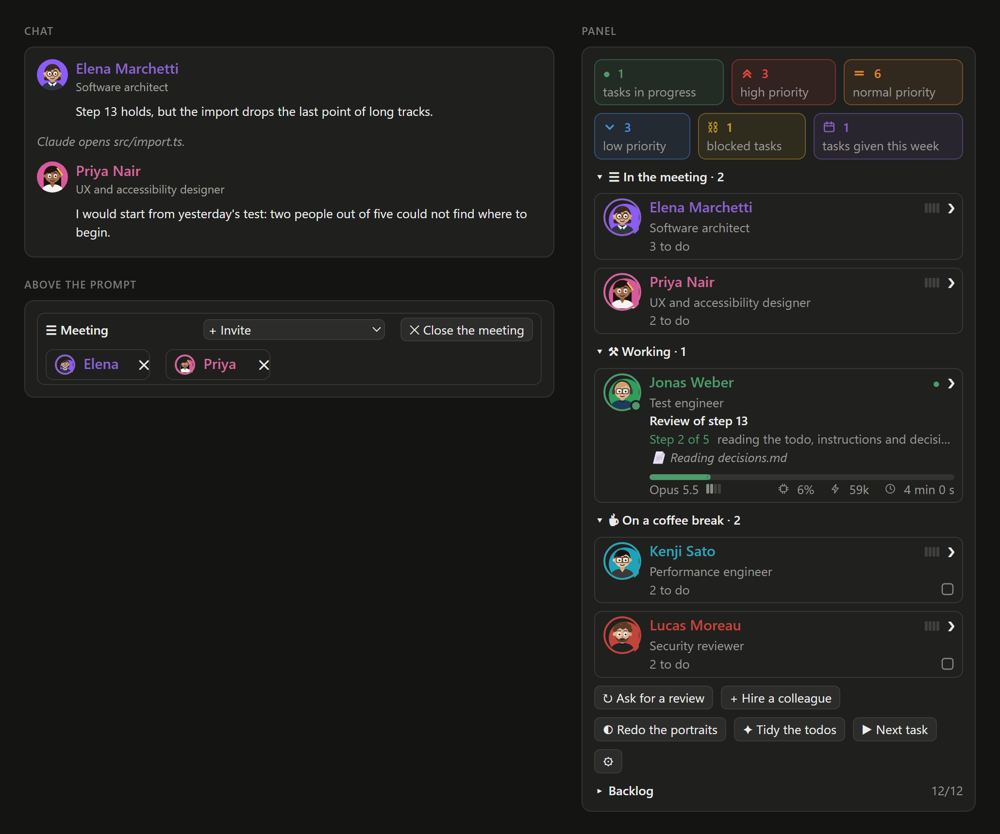

# Crew

A plugin for [Claude Code](https://claude.com/claude-code) that gives your project a standing team of expert colleagues: they review the work in their field, take tasks, and talk with you one-to-one or in a meeting.

<p align="center">
  
</p>
<p align="center"><sub>A meeting in the chat, and the panel with the team beside it.</sub></p>

## What you get

- **Colleagues** for your project's fields, each with a profile, a memory that lasts across chats and a todo.
- **Review rounds**: at a milestone, the colleagues it touches review it, and their findings reach you as proposals.
- **Tasks**: Claude hands a colleague a check, a test or a change in their field, within the permissions you give them.
- **Conversations**: a quick question, a talk with one of them, or a meeting, each answering in their own voice.
- **A panel** beside the chat with the team, who is at work and on what, their reports and their tasks.
- **Portraits**, painted by an image connector or the Codex CLI, or drawn by Claude.

Everything lives in your project's `.claude/` folder: each colleague's profile, memory, todo and notes.

## Install

You need **Claude Code**, in the desktop app or in the terminal, and **Node.js 20 or later** ([nodejs.org](https://nodejs.org)).

1. In a Claude Code chat, paste:
   ```
   Install the plugin "crew": run `claude plugin marketplace add stefanocaronia/claude-crew` and `claude plugin install crew@claude-crew`, then tell me to open a new chat.
   ```
2. Open a new chat in your project's folder (the plugin loads when a chat starts) and paste:
   ```
   Set up a team of colleagues for this project.
   ```
   Claude reads the project, proposes a few roles, and you pick who joins. If the project already has reviewer agents, Claude adopts them as colleagues.

The panel opens beside the chat by itself. When Claude asks to run `node`, allow it: the plugin runs on it.

Made for Claude Code. Codex, Gemini and Antigravity are not tested.

## Use it

Just talk to Claude:

- "hire a colleague for security"
- "run a review round on the parser"
- "ask Giulia whether the menu is clear"
- "I want to talk to Matteo and Giulia", then "back to Claude"
- "start the next task for Matteo"

Claude hands the colleagues work in their field as it goes, one task at a time each, and their findings come to you as proposals: you decide.

**Each colleague at work spends your plan's usage** as Claude does: fewer colleagues and narrower rounds spend less.

**Working with [Project](https://github.com/stefanocaronia/claude-project)?** The colleagues hold its backlog's tasks and propose new ones. Project is optional.

## Settings

Each colleague's card in the panel sets their effort and their permissions: **Read** the project, **Write** its files, **Testing**, **Web**. A reviewer starts with Read only. The panel's ⚙ picks its language and whether it opens at the start.

Claude knows the rest: ask it to change a setting.

## Learn more

- [Guide](docs/guide.md): commands, files, tasks, permissions, the panel, working with Project.
- [Contributing](CONTRIBUTING.md): trying it locally, tests, preview, releases.
- [Changelog](CHANGELOG.md): what changed, version by version.

## Credits

The step tool, the run tracking and the drawings' light and dark colors follow [savvy-progress](https://github.com/johnnyvizz/claude-kit/tree/main/plugins/savvy-progress) by johnnyvizz (MIT).

## License

MIT. Crew is an independent project, not affiliated with or endorsed by Anthropic. Claude is a trademark of Anthropic.

## Development notes

Developed with the help of AI coding agents. Everything is designed, reviewed and tested by the project's human maintainer.

**We encourage everyone to use AI for their own purposes.**  
The means of production should belong to the people.  
Fight corporate control of technology, not our right to use it.
